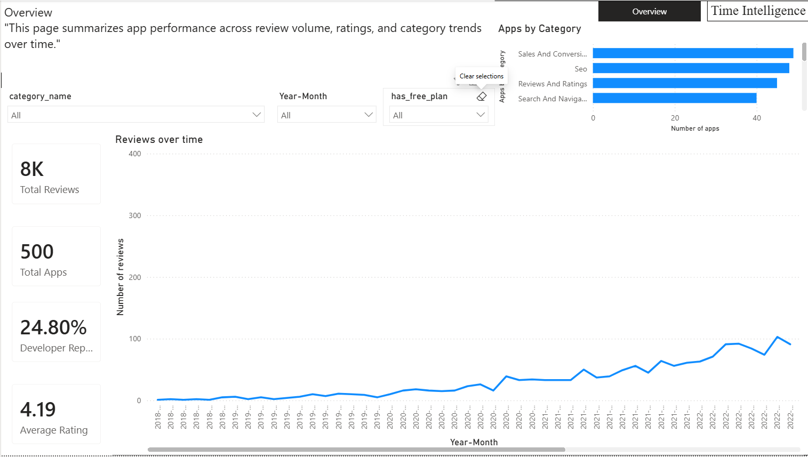

# Shopify App Store Analysis

A two-page Power BI report on 500 Shopify App Store listings and 8,240 customer reviews: which
categories are crowded, how apps are rated, how responsive developers are, and how review activity
has grown. Paired with a Python data quality audit, because the raw files have problems that change
the answers.

**Report:** [`shopify_app_store_report.pbix`](shopify_app_store_report.pbix) (Power BI Desktop)

## Overview page



## Time Intelligence page


## Key numbers

| Metric | Value |
|---|---|
| Apps | 500 across 14 categories |
| Developers | 200 (average 2.5 apps each) |
| Reviews | 8,220 valid (20 out-of-range rows excluded) |
| Average rating | **4.19 / 5** |
| Developer reply rate | **24.8%** — three out of four reviews go unanswered |
| Apps with a free plan | 198 (40%) |
| Median price (paid apps) | $19.99/month |
| Review growth | 12 reviews in 2018 → 3,918 in 2024 |

## What the data says

**Ratings are compressed at the top.** 81% of reviews are 4 or 5 stars and the category averages sit
between 4.01 and 4.39 — a 0.38 spread across the entire store. Average rating is therefore a weak
signal for ranking apps; review *volume* and reply behaviour separate listings far better.

**The busiest categories are not the best-rated.** SEO has the most reviews (1,170 across 48 apps) but
one of the lowest average ratings (4.11). Productivity is the inverse: 618 reviews at the highest
average rating in the store (4.39). Sales and Conversion is the only category that is both crowded
(48 apps, 946 reviews) and well rated (4.35).

| Category | Apps | Reviews | Avg rating | Reply rate |
|---|---|---|---|---|
| SEO | 48 | 1,170 | 4.11 | 26.3% |
| Reviews And Ratings | 45 | 1,105 | 4.20 | 24.3% |
| Sales And Conversion | 48 | 946 | 4.35 | 25.7% |
| Orders And Shipping | 36 | 796 | 4.18 | 24.4% |
| Productivity | 34 | 618 | **4.39** | 25.4% |
| Loyalty And Rewards | 26 | 494 | **4.01** | 23.7% |
| Inventory Management | 28 | 245 | 4.24 | 26.1% |

**Nobody answers the 1-star reviews.** Reply rate barely moves with rating — 16.7% on 1-star reviews
against 25.0% on 5-star reviews. Developers are, if anything, *less* likely to respond to the reviews
that damage a listing most.

**Review volume is growing fast, but the trend is confounded.** Reviews roughly doubled every year
from 2018 to 2024 (12 → 80 → 266 → 572 → 1,155 → 2,217 → 3,918). Part of that is genuine store
growth and part is survivorship: this is a snapshot of currently listed apps, so delisted apps and
their older reviews are absent. The curve overstates early-year quiet.

**Free plans don't move ratings.** Apps with a free plan average 4.20 versus 4.19 for paid-only — no
meaningful difference. The 40% that offer a free tier are not buying goodwill in the ratings.

## Recommendations

1. **Rank apps on review volume and reply rate, not stars.** With every category inside a 0.38-point
   band, average rating cannot separate a good app from a mediocre one.
2. **Treat the 16.7% reply rate on 1-star reviews as the actionable gap** — it is the cheapest lever a
   developer controls and it currently points the wrong way.
3. **Target Productivity and Sales and Conversion** for partnership or investment: high ratings with
   proven demand, versus SEO's high volume at low satisfaction.
4. **Fix the source data before extending the report** — see below. Two of the issues would materially
   change what the Time Intelligence page shows.

## Data quality issues

Found by [`analysis/data_quality_audit.py`](analysis/data_quality_audit.py). The first two are
serious:

1. **`reviews.posted_at` contains two date formats** — 6,592 rows as `YYYY-MM-DD` and 1,648 as
   `MM/DD/YYYY`. Parsing with a single fixed format silently nulls the other 20%, which would gut the
   time-series page. Parsing as mixed recovers all 8,240 rows (Jul 2018 – Dec 2024).
2. **20 ratings fall outside the 1–5 scale** — ten 0s and ten 6s. They shift the average only
   slightly (4.191 → 4.194) but they would appear as phantom buckets in any rating-distribution
   visual.
3. **Category names have inconsistent casing** — `SEO`, `STORE DESIGN`, `REVIEWS AND RATINGS`,
   `email marketing`, `orders and shipping` and `search and navigation` sit alongside title-case
   values. They must be normalised or they group inconsistently and render badly in a legend.
4. **25 apps have no `developer`** and **29 app names are duplicated**, so developer-level rollups are
   incomplete and app name is not a safe key — join on `app_id`.
5. **20 of 500 apps have zero reviews.** An inner join drops them, so any "average rating per app"
   measure is silently computed over the 480 reviewed apps only.
6. **`monthly_price_usd` is null for 198 apps** — these are the free apps, not missing data. Treating
   null as zero would be correct; treating it as missing and dropping it would bias pricing analysis
   toward premium apps.

## Known report issues (next iteration)

The screenshots above are honest about where the .pbix still needs work:

- **`Year-Month` is sorted as text, not chronologically** on the two right-hand charts of the Time
  Intelligence page (the axis reads 2021, 2018, 2019, 2020, 2022…). It needs a `Sort by column`
  against a numeric `YYYYMM` key in `dim_date`.
- **Category labels inherit the raw casing** — `Seo` appears in the Apps by Category bar chart
  because the source value is `SEO` and no cleaning step runs in Power Query.
- **Two KPI card labels truncate** (`Developer Rep...`, `Previous Yea...`); the cards need to be
  widened or the measure names shortened.
- **The Overview subtitle is wrapped in literal quote marks**, carried over from the brief.

## Repository structure

```
shopify-app-store-analysis/
├── README.md
├── shopify_app_store_report.pbix     # Current Power BI report (Overview + Time Intelligence)
├── analysis/
│   └── data_quality_audit.py         # Reproduces every issue and KPI above
├── data/
│   ├── apps.csv                      # 500 apps x 7 columns
│   └── reviews.csv                   # 8,240 reviews x 6 columns
├── screenshots/
│   ├── overview_page.png
│   ├── time_intelligence_page.png
│   └── data_model.png                # apps 1-to-many reviews on app_id
└── archive/                          # Earlier report iterations, kept for history
```

## Reproducing the audit

```bash
pip install -r requirements.txt
python analysis/data_quality_audit.py
```

## Data

| File | Rows | Columns |
|---|---|---|
| `apps.csv` | 500 | `app_id`, `app_name`, `developer`, `category_name`, `launch_date`, `has_free_plan`, `monthly_price_usd` |
| `reviews.csv` | 8,240 | `review_id`, `app_id`, `rating`, `posted_at`, `has_developer_reply`, `helpful_count` |

Related one-to-many on `app_id`. Reviews span July 2018 to December 2024.

## Tech stack

Power BI Desktop (DAX measures, time intelligence) · Python (pandas) · CSV

## License

[MIT](LICENSE)
