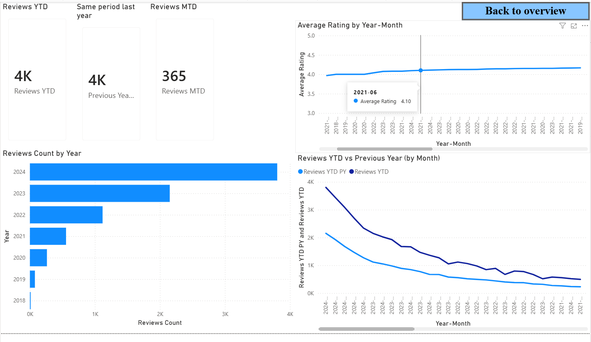

# Shopify App Store Analysis

A two-page Power BI report analyzing 500 Shopify App Store listings and 8,240 customer reviews to identify category saturation, rating trends, developer response rates, and review growth over time. Paired with a Python script (`analysis/data_quality_audit.py`) to catch raw data issues before building visuals.

**Report:** [`shopify_app_store_report.pbix`](shopify_app_store_report.pbix) (Power BI Desktop)

## Dashboard Pages

### Overview


### Time Intelligence


## Key Metrics

| Metric | Value |
|---|---|
| Total Apps | 500 across 14 categories |
| Developers | 200 (avg 2.5 apps each) |
| Valid Reviews | 8,220 (20 out-of-range rows excluded) |
| Average Rating | **4.19 / 5** |
| Developer Reply Rate | **24.8%** (roughly 3 out of 4 reviews go unanswered) |
| Free Plan Availability | 198 apps (40%) |
| Median Paid Price | $19.99/month |
| Annual Review Growth | 12 reviews in 2018 → 3,918 in 2024 |

## Key Findings

* **Ratings are tightly clustered at the top:** 81% of reviews are 4 or 5 stars, and category averages sit in a narrow 0.38-point range (4.01 to 4.39). Because star ratings barely vary, review volume and developer responsiveness are much stronger indicators of app performance.
* **High volume doesn't mean high satisfaction:** **SEO** has the most reviews (1,170 across 48 apps) but one of the lowest average ratings (4.11). **Productivity** has the highest average rating (4.39 across 618 reviews), while **Sales and Conversion** is the only category that combines high volume (48 apps, 946 reviews) with a strong rating (4.35).
* **1-star reviews get the fewest replies:** Developers reply to only **16.7%** of 1-star reviews compared to **25.0%** of 5-star reviews—leaving their most damaging feedback unanswered.
* **Free tiers don't boost ratings:** Apps with a free plan average 4.20 stars compared to 4.19 for paid-only apps.
* **Growth curve includes survivorship bias:** Review counts roughly doubled every year from 2018 to 2024, but because this snapshot only includes currently active apps, older reviews from delisted apps are missing.

| Category | Apps | Reviews | Avg Rating | Reply Rate |
|---|---|---|---|---|
| SEO | 48 | 1,170 | 4.11 | 26.3% |
| Reviews And Ratings | 45 | 1,105 | 4.20 | 24.3% |
| Sales And Conversion | 48 | 946 | 4.35 | 25.7% |
| Orders And Shipping | 36 | 796 | 4.18 | 24.4% |
| Productivity | 34 | 618 | **4.39** | 25.4% |
| Loyalty And Rewards | 26 | 494 | **4.01** | 23.7% |
| Inventory Management | 28 | 245 | 4.24 | 26.1% |

## Recommendations

1. **Evaluate apps on review volume and reply rate, not just stars:** A 4.1 vs. 4.3 rating is too narrow to separate top performers from average apps.
2. **Prioritize responding to 1-star reviews:** Raising the 16.7% reply rate on negative reviews is an immediate, low-cost way for developers to protect conversions.
3. **Focus partnerships on Productivity and Sales & Conversion:** Both categories show proven demand paired with high customer satisfaction.

## Data Quality Issues Caught (`analysis/data_quality_audit.py`)

1. **Mixed date formats in `posted_at`:** 6,592 rows use `YYYY-MM-DD` and 1,648 use `MM/DD/YYYY`. Parsing with a single format drops 20% of the dataset; mixed parsing recovers all 8,240 rows (Jul 2018 – Dec 2024).
2. **Out-of-range ratings:** 20 rows contain ratings of `0` or `6` (outside the 1–5 scale) and were excluded so they wouldn't create invalid buckets in rating visuals.
3. **Inconsistent category casing:** Values like `SEO`, `STORE DESIGN`, and `email marketing` appear alongside Title Case names and need normalization before grouping.
4. **Missing developers and duplicate app names:** 25 apps have null `developer` fields and 29 `app_name` values repeat—requiring joins on `app_id` rather than app name.
5. **Unreviewed apps & null prices:** 20 apps have zero reviews (requiring a left join so they aren't dropped from catalog counts), and 198 apps have null `monthly_price_usd` values because they are free-tier apps, not missing data.

## Planned Report Fixes (v2)

* Sort `Year-Month` chronologically on the Time Intelligence line charts using a numeric `YYYYMM` column in `dim_date` instead of alphabetical text sorting.
* Standardize category casing in Power Query (`SEO` instead of `Seo`).
* Widen the KPI cards so `Developer Reply Rate` and `Previous Year` labels don't truncate.
* Remove the literal quotation marks around the Overview page subtitle.

## Repository Structure

```text
shopify-app-store-analysis/
├── README.md
├── shopify_app_store_report.pbix      # Power BI report (Overview + Time Intelligence)
├── analysis/
│   └── data_quality_audit.py          # Python audit script verifying KPIs and data issues
├── data/
│   ├── apps.csv                       # 500 apps x 7 columns
│   └── reviews.csv                    # 8,240 reviews x 6 columns
├── screenshots/
│   ├── overview_page.png
│   ├── time_intelligence_page.png
│   └── data_model.png                 # 1-to-many relationship on app_id
└── archive/                           # Earlier report versions
